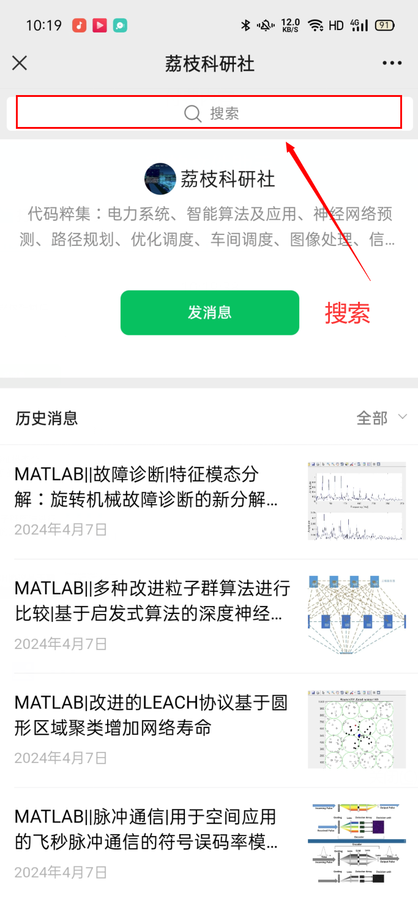

# View the program content and run results

Some students have reported that they cannot see the content of the program, and today's lesson will teach you how to view the content of the program:
Sometimes, when you want to quickly find the desired article, is there a quick method? Of course, there is. The steps are as follows:
Step two: Backstage reply: Program search
Step three: Search for the desired article:
\n        \n

## Images

<!-- PAYMENT_BLOCK -->

## Get this dataset

- Payment link (Stripe): [Buy now](https://buy.stripe.com/3cs8yP7sY87d0vu9AB)
- Payment QR code: 

<!-- /PAYMENT_BLOCK -->
